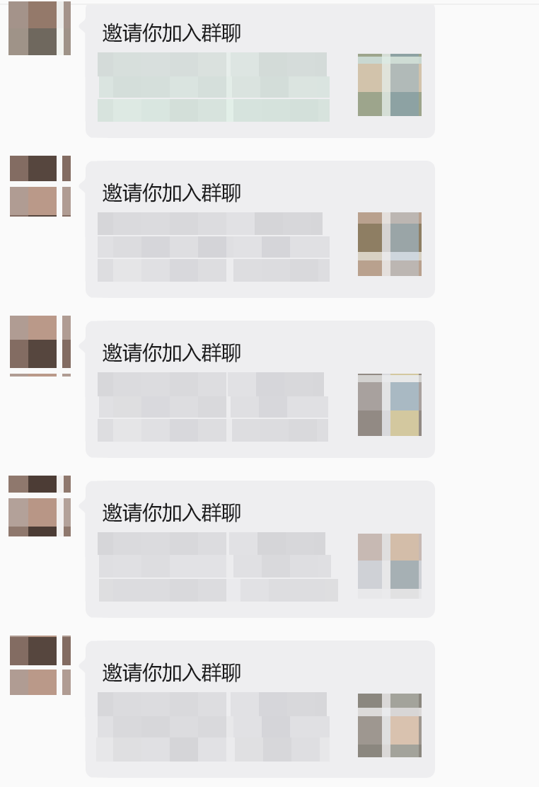
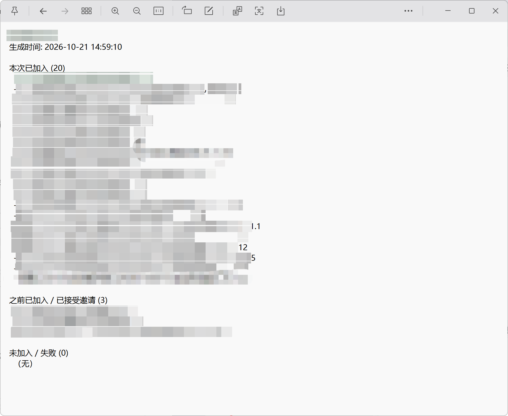

# 微信自动加群工具

基于 **微信 PC 4.1.9.35**（UIA 模式）和 **4.2.0.7**（屏幕识别模式）的群邀请自动处理工具。

> 微信 PC 4.1 起不再默认向 UI Automation 暴露完整界面树，4.2.0.7 实测同样不暴露。工具在检测不到 UIA 树时会自动切换到屏幕识别模式（见下文“屏幕模式”）。

平时在微信里加群，需要一张张点开“邀请你加入群聊”卡片，再点“在微信中打开”，最后点“加入群聊”。这个工具可以指定**邀请人/聊天名称**和**聊天记录开始时间**，自动扫描该时间之后的邀请卡片，并逐个完成入群操作。

遇到“你已接受该邀请”的群会自动跳过，最后输出本次加入了哪些群、哪些群之前已经加入、哪些群没有加入成功。

> 仅用于处理自己收到的群邀请。请遵守微信使用规范，不要用于批量骚扰、营销或任何违规用途，使用风险自负。

## 效果示例

微信里的群邀请卡片：



运行结束后的结果清单：



## 功能

- 按聊天名称自动打开对应聊天
- 按开始时间定位聊天记录，只处理该时间之后的邀请
- 自动滚动、收集、去重邀请卡片
- 自动右键卡片，选择“在微信中打开”
- 自动识别内嵌邀请页的“加入群聊”按钮并点击
- 自动识别“你已接受该邀请”，跳过已经加入的群
- 支持断点续跑：已加入、之前已加入的群不会重复处理
- 输出 `state.json`、`result.csv` 和可读的 `not_joined.txt`
- 支持试运行、限制处理数量、强制重跑、手动标记已加入

## 环境要求

- Windows 10 / 11
- 微信 PC 版 **4.1.9.35**（UIA 模式）或 **4.2.0.7**（屏幕模式，实验性）
  - 4.1.9.35 使用 UI Automation 读取聊天和卡片，可按时间过滤。
  - 4.2.0.7 不暴露 UIA 树，自动改用截图识别：无法按时间过滤，用卡片指纹去重。
- Go **1.25+**
- 微信已登录，且处于可操作的桌面会话中
- 运行期间不要移动鼠标、不要操作键盘、不要锁屏或断开远程桌面
- 建议使用微信默认主题和默认缩放；已在 3840×2160 环境验证，其他分辨率、主题、多显示器环境未充分验证

## 快速开始

```powershell
cd D:\code\wechatJoinGroup
go mod download
```

先做一次试运行，只扫描不加入：

```powershell
go run . -dry-run -chat "XXXX" -since "2026-10-21 11:55"
```

确认扫描到的群正确后，先处理 1 个测试：

```powershell
go run . -limit 1 -chat "XXXX" -since "2026-10-21 11:55"
```

测试正常后处理全部：

```powershell
go run . -chat "XXXX" -since "2026-10-21 11:55"
```

其中：

- `-chat`：邀请人/聊天名称，工具会用微信搜索打开这个聊天。建议填写备注名或完整昵称，确保搜索结果第一个就是目标聊天。
- `-since`：只处理这个时间之后的邀请，格式 `2006-01-02 15:04`。工具会在聊天记录中查找对应的 `HH:MM` 时间分隔。

运行过程中会自动把微信切到前台，并模拟鼠标点击。请不要抢占鼠标和键盘。

## 参数说明

| 参数 | 默认值 | 说明 |
| --- | --- | --- |
| `-chat` | `XXXX` | 要扫描的聊天/邀请人名称 |
| `-since` | `2026-10-21 11:55` | 只处理该时间之后的邀请，格式 `2006-01-02 15:04` |
| `-out` | `out` | 结果文件和调试截图的输出目录 |
| `-limit` | `0` | 最多处理多少个邀请，`0` 表示不限制 |
| `-dry-run` | `false` | 只扫描并列出邀请，不执行加入 |
| `-force` | `false` | 忽略已有记录，重新处理所有扫描到的邀请 |
| `-oldest` | `false` | 从旧到新处理；默认从新到旧 |
| `-mark-already` | 空 | 把指定群精确标记为“之前已加入”，不启动微信自动化 |
| `-screen` | `false` | 强制使用屏幕识别模式；检测不到 UIA 树时会自动启用 |
| `-pages` | `20` | 屏幕模式最多向上扫描多少页聊天 |
| `-no-bottom` | `false` | 屏幕模式不先滚到最底部，从当前聊天位置开始扫描 |

### 屏幕模式（微信 4.2+）

微信 4.1 起用 `UiaClientsAreListening` / `gAccessibilityMode` 控制 UI 树暴露，
4.2.0.7 实测仍然只暴露两三个空节点，UIA 模式无法定位聊天和卡片，此时工具会自动切换到屏幕模式：

```powershell
# 自动回退（推荐）
go run . -chat "包承昊"

# 强制屏幕模式，只扫描底部 30 页
go run . -screen -chat "包承昊" -pages 30

# 已经手动把聊天滚动到目标位置，从当前位置开始
go run . -screen -no-bottom -pages 3 -chat "包承昊"
```

屏幕模式会：
- 用搜索框打开指定聊天，滚到最底部后逐页向上扫描；
- 通过气泡底色 (238,238,240) 加红色/彩色缩略图定位邀请卡片；
- 右键卡片选“在微信中打开”，识别绿色“加入群聊”或灰色“你已接受该邀请”；
- 用卡片缩略图的灰度网格签名去重，签名写入 `state.json`，下次运行自动跳过。

限制：
- 无法读取时间分隔和群名，`-since` 不生效，报告里用 `卡片#<签名>` 标识卡片；
  若内嵌页窗口标题可读，会把标题附加到原因里。
- 依赖微信默认主题、默认缩放和可见窗口；窗口尺寸变化会降低识别率。
- 聊天记录很长时请用 `-pages` 限制扫描页数，避免读取过多历史。

### 手动标记已加入

有时你已经手动进过某个群，但邀请页没有出现可识别的灰色按钮，工具会把它记为失败。可以按群名精确标记：

```powershell
go run . -mark-already "261015群聊名称A"
```

标记后会更新 `state.json`、`result.csv` 和 `not_joined.txt`。

## 输出文件

默认输出到 `out/`：

| 文件 | 说明 |
| --- | --- |
| `state.json` | 断点续跑状态，记录每个群的状态、原因、邀请卡片内容和处理时间 |
| `result.csv` | 每个群一行的结果表，UTF-8 BOM，列：群名、状态、原因、邀请卡片、时间 |
| `not_joined.txt` | 给人看的结果汇总，分为“本次已加入”“之前已加入/已接受邀请”“未加入/失败” |
| `*_no_button.png` | 未找到加入按钮时的内嵌网页截图，用于排查 |
| `*_join_failed.png` | 点击加入后按钮仍然存在时的截图 |

状态含义：

| 状态 | 含义 |
| --- | --- |
| `joined` | 本次成功点击加入 |
| `already_joined` | 页面显示“你已接受该邀请”，或手动标记为之前已加入 |
| `failed` | 未找到菜单、未打开网页、未找到按钮、邀请失效等 |

`joined` 和 `already_joined` 默认会跳过；`failed` 下次运行时会自动重试。使用 `-force` 可以强制重跑全部。

## 工作原理

1. 通过 Windows UIA 找到微信主窗口和聊天消息列表。
2. 用搜索框打开 `-chat` 指定的聊天，滚动到底部。
3. 从底部向上查找 `-since` 对应的 `HH:MM` 时间分隔。如果找不到，会尝试 `-since + 1 分钟` 作为兜底。
4. 收集该时间之后的 `mmui::ChatBubbleItemView`，筛选名称中包含“邀请你加入群聊”的卡片，并用正则提取群名去重。
5. 处理每张卡片前重新定位卡片并尽量滚动到消息列表中间，避免卡片在边缘或位置过期导致右键点空。
6. 右键卡片，在微信主窗口和顶层菜单窗口中查找“在微信中打开”，点击菜单项。
7. 微信会用内嵌 Chromium 打开邀请页。该网页内容无法通过 UIA 读取，因此工具对网页区域截图并按颜色识别按钮：
   - 绿色 `#07C160`：加入群聊
   - 灰色 `#F2F2F2`：你已接受该邀请 / 我知道了
8. 点击绿色按钮。按钮消失后即认为加入成功；如果跳到 `ERR_INVALID_URL` 页面，也属于微信的正常跳转结果。
9. 把结果写入 `state.json`，并刷新 `result.csv` 和 `not_joined.txt`。

## 已知限制

- UIA 模式只适配微信 PC **4.1.9.35**。微信更新后 UIA 类名、菜单结构或按钮颜色可能变化，需要重新适配。
- 屏幕模式适配 **4.2.0.7**，属于实验能力：依赖窗口尺寸、默认主题和缩放，且无法按时间过滤、无法读取群名。
- 屏幕模式通过图像签名去重，同一张卡片在不同窗口尺寸下签名可能有差异，必要时用 `-force` 重跑或在 `out/` 中核对。
- 网页按钮识别依赖颜色。自定义主题、系统颜色滤镜、缩放或渲染差异可能导致识别失败。
- 时间定位按 `HH:MM` 分隔符匹配，不区分日期。建议 `-since` 使用当天的聊天时间；跨天记录可能匹配到其他日期的同一时刻。
- 如果开始时间太早，工具需要向上滚动很多次才能找到，超过扫描上限会报“未找到时间分隔”。可以先把聊天滚动到目标时间附近再运行。
- 工具通过“绿色按钮消失”判断加入成功，并未二次查询群成员列表。建议运行结束后抽查会话列表。
- 内嵌网页面板当前是复用而不是关闭，连续处理时依赖微信自行导航到下一张邀请页。
- 多显示器、远程桌面断开、锁屏、非默认缩放等环境未充分验证。
- 运行时会占用鼠标和键盘，请勿同时操作电脑。

## 常见问题

### 提示“未找到时间分隔”

聊天记录中没有找到 `-since` 对应的 `HH:MM`。确认时间格式正确，或先把聊天滚动到该时间附近再运行。

### 提示“未找到群邀请卡片”

可能是邀请卡片已被删除、聊天已滚动到别处，或群名提取不一致。先用 `-dry-run` 看扫描结果。

### 提示“右键菜单中未找到‘在微信中打开’”

通常是卡片没有完全可见、右键点空，或菜单尚未弹出。工具会自动居中卡片并换位置重试。仍然失败时，用 `-limit 1` 单独运行并观察微信界面。

### 提示“未找到加入按钮，可能邀请已失效”

可能是邀请已过期、已经加入但页面没有显示灰色按钮，或网页尚未加载完成。查看 `out/*_no_button.png`；如果确认已经加入，用 `-mark-already` 标记。

### 搜索结果不是目标聊天

`-chat` 需要填写能唯一搜到目标聊天的名称。建议使用完整备注名，避免使用过于宽泛的关键词。

## 开发

```powershell
go build ./...
```

目录结构：

```text
.
├── main.go                     CLI 入口
├── internal/
│   ├── uia/                    Windows UIA 封装
│   ├── win32/                  DPI、鼠标、键盘、窗口操作
│   └── wechat/
│       ├── wechat.go           聊天定位、卡片收集、右键菜单、入群流程
│       ├── screen.go           内嵌网页截图与按钮颜色识别
│       └── report.go           状态、CSV、结果汇总
├── groupinvite.png             邀请卡片示例
├── resulttext.png              结果清单示例
└── out/                        运行输出
```
